


<h2></h2>

<a href="https://github.com/ramin-mahmoodi/IranTUN"></a>&nbsp;<a href="https://github.com/ramin-mahmoodi/Hemera"></a>

<a href="https://github.com/ramin-mahmoodi/3x-hub"></a>&nbsp;<a href="https://github.com/ramin-mahmoodi/ArvanScanner"></a>

<a href="https://github.com/ramin-mahmoodi/MTLink"></a>&nbsp;<a href="https://github.com/ramin-mahmoodi/NanoRay"></a>

<a href="https://github.com/ramin-mahmoodi/RealityScanner"></a>&nbsp;<a href="https://github.com/ramin-mahmoodi/ternaryphasediagram"></a>


<a href="mailto:78ramin@gmail.com"></a>

